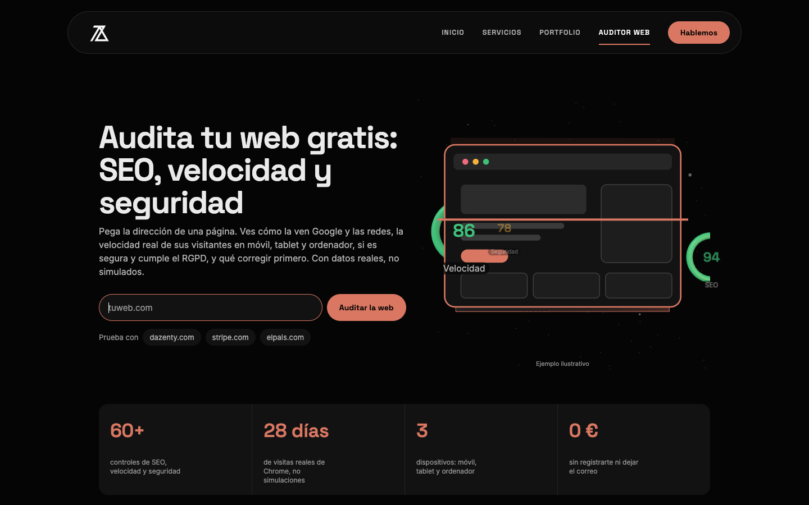
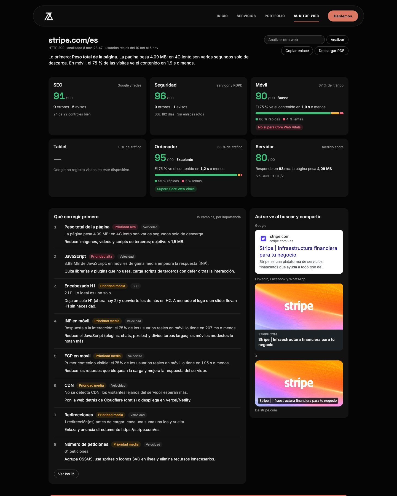
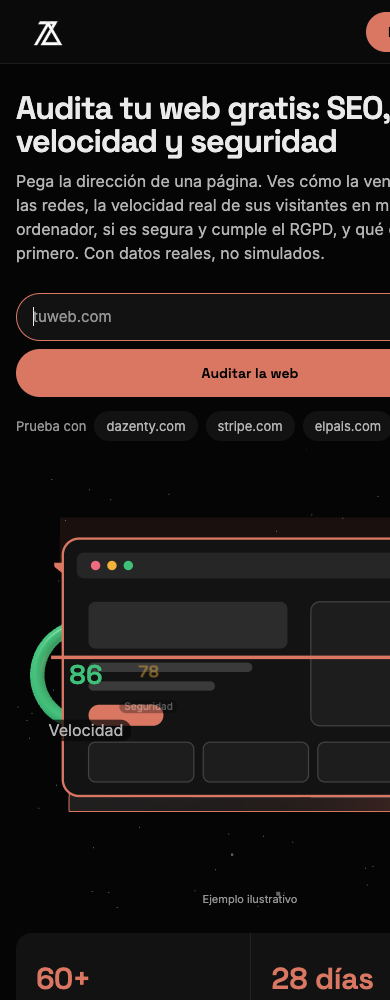
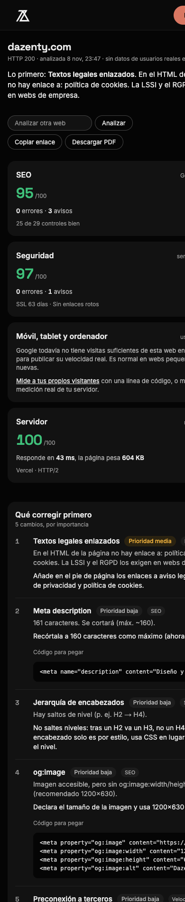
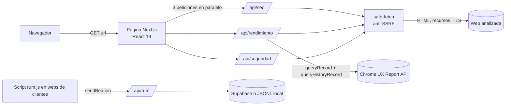

<div align="center">

# Auditor Web Gratis

**SEO, velocidad con datos reales de usuarios y seguridad/RGPD de cualquier web, en un solo informe.**

[](https://github.com/ELMURGA/Auditor-web-Gratis/actions/workflows/ci.yml)




</div>

Herramienta que desarrollé para [Dazenty](https://dazenty.com), mi estudio de diseño web y automatización con IA. Se pega una URL y, en unos segundos, se obtiene una auditoría completa con **una lista única de qué corregir primero**, con el código listo para pegar.

> Nace de una frustración concreta: casi todos los medidores de velocidad dan una nota **simulada** en un móvil de laboratorio que no existe. Aquí la velocidad sale de **visitas reales de Chrome** (el mismo dato que Google usa para posicionar) y de mediciones de red hechas de verdad contra el servidor.

## Qué hace

| | |
|---|---|
| **SEO** (29 controles) | Título, descripción, canonical, robots, viewport, idioma, JSON-LD (valida el JSON y lista los `@type`), hreflang, encabezados, imágenes sin `alt`, Open Graph y tarjeta de X (comprueba que la imagen carga de verdad), código de respuesta, redirecciones, `robots.txt` y sitemap. Con la **vista previa real** en Google, LinkedIn/WhatsApp y X. |
| **Velocidad real** | Los últimos 28 días de visitas reales de Chrome ([CrUX](https://developer.chrome.com/docs/crux)) por **móvil, tablet y ordenador**: LCP, INP, CLS, FCP, TTFB y RTT al percentil 75, la distribución de visitas buenas/mejorables/malas, si supera las Core Web Vitals, el desglose del LCP y la evolución semanal de 6 meses. Más una **medición real del servidor**: DNS, conexión, TLS, TTFB y descarga con conexiones nuevas, HTTP/2, CDN, compresión, caché y el peso real de cada recurso. |
| **Seguridad y RGPD** | Certificado SSL y días restantes, redirección http→https, HSTS, CSP, clickjacking, `nosniff`, Referrer/Permissions-Policy, versiones de software expuestas, contenido mixto, cookies sin `Secure`/`HttpOnly`, `security.txt`, banner de cookies frente a analítica/píxeles, textos legales (LSSI/RGPD), consentimiento en formularios, enlaces rotos y **tecnología detectada** (CMS, constructor, analítica, hosting…). |
| **Mis visitantes (RUM)** | Un script de una línea que mide las Web Vitals de cada visitante real. Pensado para webs con poco tráfico que no aparecen en CrUX. Sin cookies ni datos personales. |
| **Informe accionable** | Una sola lista ordenada por prioridad que mezcla SEO, velocidad, seguridad y enlaces, con la explicación, el arreglo y el código para pegar. **Descarga en PDF** y enlace para compartir (`?url=dominio.com`). |

<div align="center">

</div>

<details>
<summary><b>Ver en móvil</b></summary>
<br>
<div align="center">

&nbsp;&nbsp;

</div>
</details>

## Por qué los datos son reales

| | Medidores habituales | Este auditor |
|---|---|---|
| Origen | Una carga simulada en un móvil de laboratorio | Visitas reales de usuarios de Chrome durante 28 días |
| Métrica | Una nota 0-100 inventada | Percentil 75 de cada métrica con los umbrales oficiales de Core Web Vitals |
| Dispositivos | Uno, emulado | Móvil, tablet y ordenador, con su porcentaje de tráfico |
| Servidor | Estimado | Tres conexiones reales y nuevas medidas con `node:http`/`node:tls` |
| Peso | Estimado | Cada recurso se descarga y se mide |
| Sin datos | Se inventa una nota | Se dice que no hay datos y se ofrece medir a los propios visitantes |

La nota por dispositivo se calcula **solo** con datos reales: para LCP, INP, CLS y FCP, el porcentaje de visitas buenas (más la mitad de las mejorables), ponderado 35 / 30 / 25 / 10. Una web que no supera las Core Web Vitals no puede puntuar «Excelente» aunque la media sea alta.

## Arquitectura



Las tres auditorías se lanzan **a la vez** y el informe se va rellenando según llegan: el SEO aparece en ~3 s y la velocidad (la más lenta, ~20 s) completa las tarjetas y la lista de mejoras sin bloquear lo demás.

## Decisiones técnicas

- **Anti-SSRF.** Es una herramienta que hace peticiones a URLs que escribe el usuario, así que el servidor no puede convertirse en un proxy hacia la red interna. `lib/safe-fetch.ts`: solo `http(s)` en los puertos 80/443, sin credenciales en la URL, resolución DNS y bloqueo de rangos privados, de enlace local, CGNAT y de metadatos de nube (IPv4 e IPv6, incluido `::ffff:`), redirecciones seguidas **a mano** revalidando cada salto, y límites de tiempo y de tamaño de respuesta. Las conexiones TLS y HTTP de bajo nivel validan la IP en el propio `lookup` para evitar DNS rebinding. Cubierto por tests.
- **Parser de `robots.txt` por grupos**, con la semántica de Google (usa el grupo de `Googlebot` si existe, si no el de `*`; un `Allow` puede reabrir lo que un `Disallow` cierra). La primera versión usaba una expresión regular y daba falsos positivos con webs que bloquean a otros bots; se sustituyó y se cubrió con tests.
- **Medición de red propia.** DNS, conexión, TLS, TTFB y descarga se miden con los eventos del socket, con una conexión nueva en cada ejecución y la mediana de tres. HTTP/2 se detecta con un handshake TLS/ALPN independiente.
- **Privacidad por diseño en el RUM.** Sin cookies ni identificadores. Solo se aceptan datos de dominios en una lista de permitidos, con validación de rangos por métrica, límite de tamaño y de peticiones, y la consulta puede protegerse con un token.
- **Escena 3D que no estorba.** `three.js` se carga aparte y solo en la portada (el informe no paga su peso), se pinta cuando el navegador está libre, se pausa fuera de pantalla y en pestañas ocultas, respeta `prefers-reduced-motion` y el ahorro de datos, baja la calidad en equipos justos y, si no hay WebGL, queda un dibujo plano. Las notas que orbitan son HTML (texto nítido y accesible) posicionado con la proyección de la cámara.
- **PDF sin librerías.** Hoja de estilos de impresión que convierte el informe a blanco, despliega las tres pestañas y evita cortes dentro de tarjetas.
- **Accesibilidad.** Etiquetas en todos los controles, estados con texto (no solo color), foco visible, contraste revisado y diseño sin scroll horizontal desde 375 px.

## Stack

| | |
|---|---|
| Framework | Next.js 15 (App Router, Route Handlers), React 19, TypeScript 5 |
| 3D | three.js 0.160 |
| Análisis HTML | cheerio |
| Datos | Chrome UX Report API y History API · Supabase (opcional, para el RUM) |
| Métricas de campo en cliente | `web-vitals` |
| Calidad | `node:test`, `tsc --noEmit`, GitHub Actions |

Sin librerías de gráficos ni frameworks de CSS: los gráficos son SVG propio y el estilo, CSS plano con variables. La base de datos (Supabase) solo es necesaria para el RUM en producción.

## Estructura

```
app/
  page.tsx               Portada + informe unificado (estado de las 3 auditorías)
  rum/page.tsx           Panel «Mis visitantes»
  api/{seo,rendimiento,seguridad,rum}/route.ts
  components/            Bar, Hero3D, seo, perf, security
lib/
  safe-fetch.ts          Fetch seguro (anti-SSRF, redirecciones, límites)
  analyze.ts · robots.ts SEO y parser de robots.txt
  crux.ts · score.ts     Chrome UX Report, umbrales y notas por dispositivo
  measure.ts             Medición real de red, peso y recursos
  security.ts            Cabeceras, SSL, RGPD, enlaces y tecnología
  rum-store.ts           Almacén del RUM (Supabase o JSONL)
public/rum.js            Script de monitorización de visitantes
tests/                   20 tests (SSRF, robots.txt, límites, umbrales)
supabase.sql             Tabla del RUM
```

## Empezar

Requiere **Node 20+** para ejecutar la app. Los tests usan el soporte nativo de TypeScript de Node (**22.18 o superior**; la CI usa 24).

```bash
git clone https://github.com/ELMURGA/Auditor-web-Gratis.git
cd Auditor-web-Gratis
npm install
cp .env.example .env.local     # rellena CRUX_API_KEY
npm run dev                    # http://localhost:3000/auditor
```

### Clave de Chrome UX Report (gratuita)

1. [Google Cloud Console](https://console.cloud.google.com/) → crea o elige un proyecto.
2. *APIs y servicios* → *Biblioteca* → activa **Chrome UX Report API**.
3. *Credenciales* → *Crear credenciales* → *Clave de API*, y **restríngela a esa API**.
4. Ponla en `CRUX_API_KEY`. Límite: 150 consultas/min, sin coste.

Sin clave la app funciona, pero la velocidad cae a los datos de campo de PageSpeed, cuya cuota anónima suele estar agotada.

### Variables de entorno

| Variable | Para qué |
|---|---|
| `CRUX_API_KEY` | Datos reales de velocidad (móvil, tablet, ordenador e histórico) |
| `NEXT_PUBLIC_BASE_PATH` | Ruta donde se sirve (`/auditor` por defecto; vacío = raíz) |
| `NEXT_PUBLIC_SITE_URL` | Web de la marca a la que enlazan el menú y el pie |
| `NEXT_PUBLIC_WHATSAPP` | Botón de WhatsApp del informe (vacío = sin botón) |
| `RUM_ALLOWED_HOSTS` | Dominios que pueden enviar datos de visitantes (obligatorio en producción) |
| `RUM_DASHBOARD_TOKEN` | Protege la consulta del panel RUM |
| `SUPABASE_URL`, `SUPABASE_SERVICE_ROLE_KEY` | Persistencia del RUM (crea la tabla con `supabase.sql`) |

### Scripts

```bash
npm run dev         # desarrollo
npm run build       # compilación de producción
npm start           # servidor de producción
npm run typecheck   # tsc --noEmit
npm test            # 20 tests con node:test
```

## API

Todas bajo la ruta base (`/auditor` por defecto). Límite de peticiones por IP: SEO 10/min, velocidad 6/min, seguridad 8/min, RUM 60/min.

| Endpoint | Descripción |
|---|---|
| `GET /api/seo?url=` | Informe SEO con vistas previas, controles, encabezados y JSON-LD |
| `GET /api/rendimiento?url=` | Datos de campo (CrUX) por dispositivo, histórico, medición de red y controles |
| `GET /api/seguridad?url=` | Certificado, cabeceras, RGPD, enlaces rotos y tecnología |
| `POST /api/rum` | Recibe métricas de `rum.js` (solo dominios autorizados) |
| `GET /api/rum?site=` | Resumen por dispositivo y página (p75) |

## Despliegue

Pensada para servirse bajo `/auditor` de un dominio existente. En Vercel, se despliega como proyecto aparte y se enlaza con una redirección interna en la web principal:

```json
{ "source": "/auditor", "destination": "https://TU-PROYECTO.vercel.app/auditor" },
{ "source": "/auditor/:path*", "destination": "https://TU-PROYECTO.vercel.app/auditor/:path*" }
```

Para servirla en la raíz de un dominio, `NEXT_PUBLIC_BASE_PATH=` (vacío).

## Limitaciones conocidas

Para no vender humo:

- **CrUX necesita tráfico.** Las webs con pocas visitas no tienen datos en Google; para eso existe el RUM propio. Tablet suele tener muy pocos datos.
- **El análisis SEO lee el HTML sin ejecutar JavaScript**, igual que el primer rastreo de un buscador. En una SPA pura avisa de que casi no hay texto, pero no ve lo que pinta el cliente.
- **La medición del servidor se hace desde donde está desplegada la app**, no desde el país del visitante. Por eso se complementa con los datos de usuarios reales.
- **El límite de peticiones está en memoria** (por instancia). En producción con varias instancias conviene moverlo a Redis/Upstash.
- **Enlaces rotos:** se comprueban hasta 40 por página (los internos primero).
- **En Vercel el disco no persiste**, así que el RUM necesita Supabase en producción.
- La **detección de tecnología** usa firmas propias (~35), no una base de datos completa tipo Wappalyzer.

## Hoja de ruta

- [ ] Historial de auditorías de una web y comparación entre fechas
- [ ] Rastreo de varias páginas y mapa del sitio
- [ ] Límite de peticiones distribuido (Upstash)
- [ ] Informe por correo y alertas cuando una nota baja
- [ ] Más idiomas

## Licencia y marca

Código bajo licencia [MIT](LICENSE). El nombre, el logotipo y la identidad visual de Dazenty (`public/logo-dazenty.webp`, `public/favicon.webp`) son propiedad de su autor y no están cubiertos por esa licencia. `public/web-vitals.iife.js` es la librería [`web-vitals`](https://github.com/GoogleChrome/web-vitals) de Google (Apache-2.0).

Las capturas muestran análisis de páginas públicas con fines ilustrativos.

## Autor

**Alejandro Hernández Murga** · [Dazenty](https://dazenty.com) · [@ELMURGA](https://github.com/ELMURGA)

Diseño web, software a medida y automatizaciones con IA.
